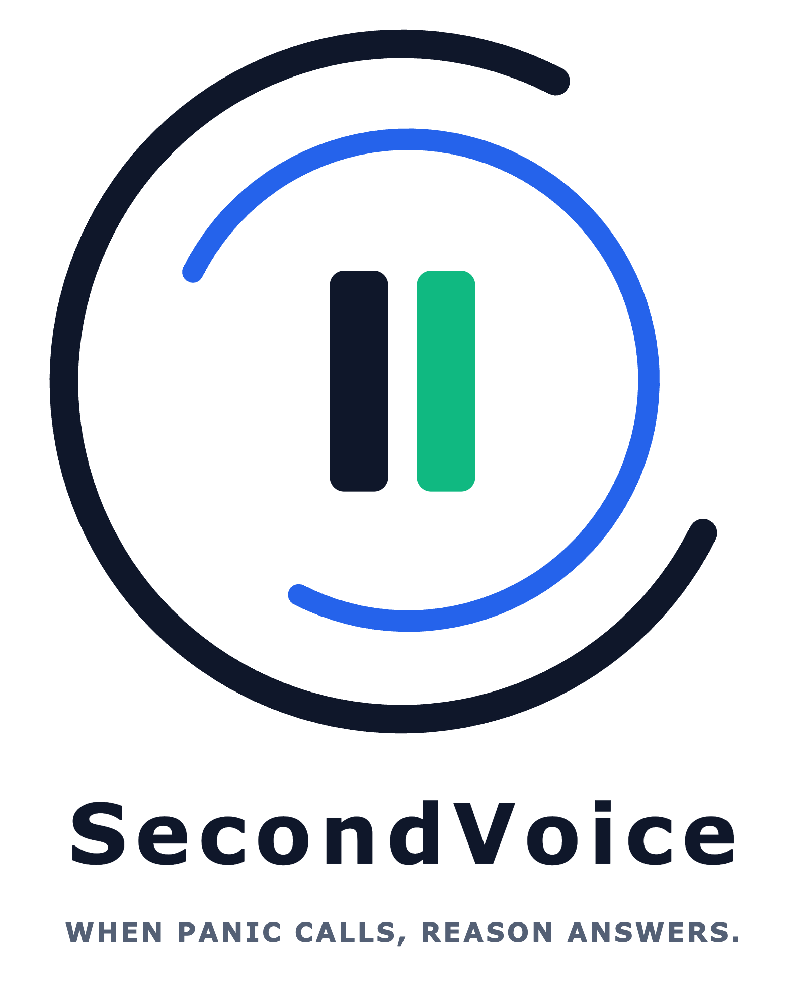
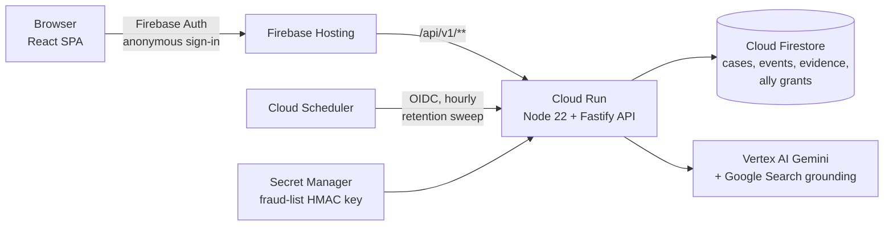

<p align="center"></p>

# Second Voice

**When panic calls, reason answers.** Second Voice is the calm second voice on a suspicious call. It helps a person under pressure slow down, check what the caller claims, bring in a trusted ally, and, if money has already moved, turn everything into a ready-to-file recovery case.

Built for the **AI Builder Cup 2026**, theme **BFSI: Intelligent Risk, Fraud & Financial Experiences**.

**Live app:** https://second-voice-b2c94.web.app (open it in two browser profiles to play the user and their ally)

## The problem

Scam callers isolate their victim: "Your account is compromised, move your money to this safe account now, and don't tell anyone." Existing tools flag a number or show a warning, but the hard part comes after: a frightened person has to work out whether the claim is true, find a real number to check it, involve someone they trust without retelling everything, and act fast if they've already paid.

## What Second Voice does

1. **Screens the call before pickup.** Checks the caller against numbers already confirmed as fraud and warns before they answer.
2. **Listens and understands.** Transcribes the call and uses Gemini to extract who the caller claims to be, what they want, and the pressure tactics they use (urgency, secrecy, threats), each linked to the line it came from.
3. **Checks the claims.** Gemini with Google Search grounding looks up the claimed organisation's official contact number and judges whether the requested procedure is something a real bank would ever ask for.
4. **Changes the decision, not just the warning.** Before a risky transfer, the user gets a calm pause with clear next steps: call the official number, or ask their ally.
5. **Brings in a trusted ally.** One tap shares exactly the evidence the user picks with a pre-paired ally, who sees the case and responds.
6. **Recovers if they already paid.** "I already paid" turns the same case into a recovery packet: a timeline, evidence, and a pre-filled report for the 1930 helpline / cybercrime.gov.in that the user files themselves. Once the user confirms fraud, the number goes on their fraud-number list, so they're warned before picking up if it calls again.

The in-app **About** screen lists which integrations are illustrative in this prototype (bank connection and account freeze, caller-ID lookup, and the report channel). All data is sample data.

## Architecture



- The browser never talks to Firestore or Gemini directly; Firestore rules deny all client access.
- Three separate auth paths: Firebase ID tokens for `/api/v1/**`, a scheduler-only OIDC identity for `/internal/retention/sweep`, and nothing else.
- Case data expires on a retention schedule. Fraud numbers are stored only as HMAC hashes.

### Google technologies

| Technology | How it helps Second Voice |
| --- | --- |
| Gemini on Vertex AI (Google Gen AI SDK) | Transcribes the call, extracts the caller's claims, requests and pressure tactics, and drafts the recovery script |
| Google Search grounding | Finds the claimed organisation's official contact number and checks whether a real bank would ask for this |
| Cloud Run | Runs the API in asia-south1 and scales to zero when idle |
| Firebase Hosting | Serves the app and routes `/api/v1/**` to Cloud Run on the same origin |
| Firebase Authentication | Anonymous sign-in gives each user and ally an identity without collecting personal data |
| Cloud Firestore | Stores cases, events, evidence and ally grants, with server-only access |
| Cloud Scheduler | Triggers the hourly retention sweep that deletes expired case data |
| Secret Manager | Holds the key used to hash fraud numbers |
| Cloud Build + Artifact Registry | Build and store the API container image for deploys |

## Repository layout

| Path | Contents |
| --- | --- |
| `apps/web` | React + Vite + Tailwind SPA |
| `apps/api` | Fastify API: case store, policy and transitions, Gemini adapters, ally sharing, recovery, export |
| `packages/contracts` | Shared TypeScript types between web and API |
| `apps/android` | Optional Android companion (WebView shell + consented SMS signal) |
| `docs/design/wireframes` | Wireframes for every screen |

## Run it locally

Needs Node 22+ and JDK 21 (for the Firebase emulators). No cloud account needed.

```bash
npm ci
npm run dev:api   # Auth + Firestore emulators, API on :8787 with a deterministic fake Gemini
npm run dev:web   # SPA on http://localhost:5173
```

Use a live model locally with `npm run dev:api:live` (set `GEMINI_API_KEY`, or `GOOGLE_CLOUD_PROJECT` with Application Default Credentials). Tests: `npm test`. Full local, live-model, and Google Cloud deploy steps are in [`docs/demo-runbook.md`](docs/demo-runbook.md).

## How we built this

A spec-driven build with AI coding agents: the product requirements are in [`Decision_Safety_Network_PRD_Draft.md`](Decision_Safety_Network_PRD_Draft.md), design decisions in [`project/decisions/`](project/decisions/), and each task with its verification evidence in [`project/tasks/`](project/tasks/).

## License

[MIT](LICENSE)
