# Second Voice: judges' testing guide

About 10 minutes. You play two people: **the user** who gets a scam call, and **their Safety Ally**, someone they trust. Each needs a separate browser session.

**Live app:** https://second-voice-b2c94.web.app

## Before you start: open two sessions

| Window | How to open | URL |
| --- | --- | --- |
| **A: the user** | Your normal browser window | https://second-voice-b2c94.web.app |
| **B: the ally** | A private/incognito window, or a second browser profile | https://second-voice-b2c94.web.app/?role=ally |

Sign-in is automatic and anonymous. Use made-up names and numbers; everything in the app is sample data. Put the two windows side by side.

> Two tabs in the same window share one sign-in, so window B must be incognito or a different browser profile.

## Part 1: connect the user and the ally (2 minutes)

**1. Window B (ally):** enter a name (e.g. *Asha*), a sample mobile number, and click **Save my details**. Then click **Get pairing code** and copy the code.

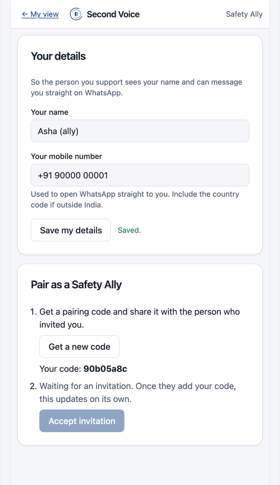

**2. Window A (user):** click **Go to Settings to set up**.

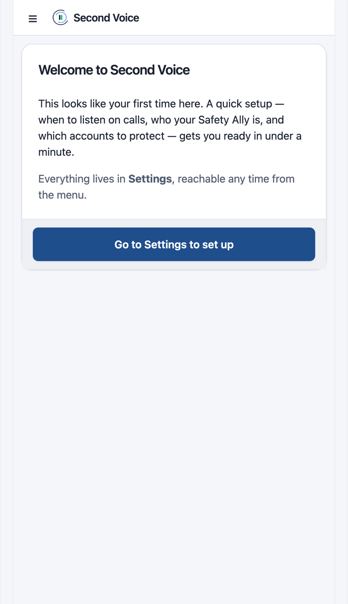

**3. Window A:** enter your name and a sample mobile number, click **Save my details**. Under **When to listen**, pick **All calls**. Paste the ally's code into **Connect your own ally**, then click **Save settings** at the bottom. A sample protected account is already added.

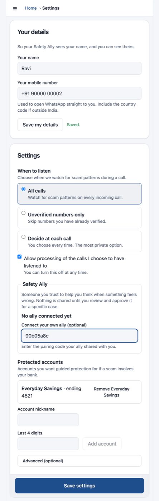

**4. Window B:** within about 10 seconds it says *You've been invited*. Click **Accept invitation**.

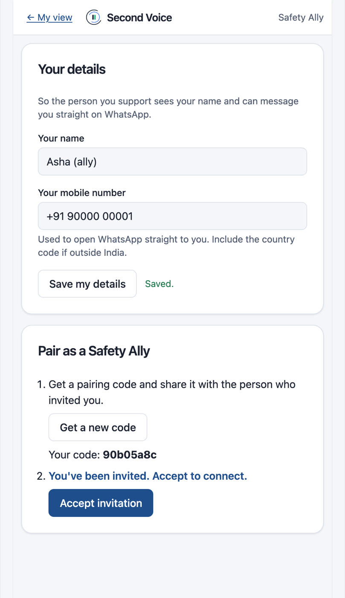

**5. Window A:** Home now shows **Ally ready**.

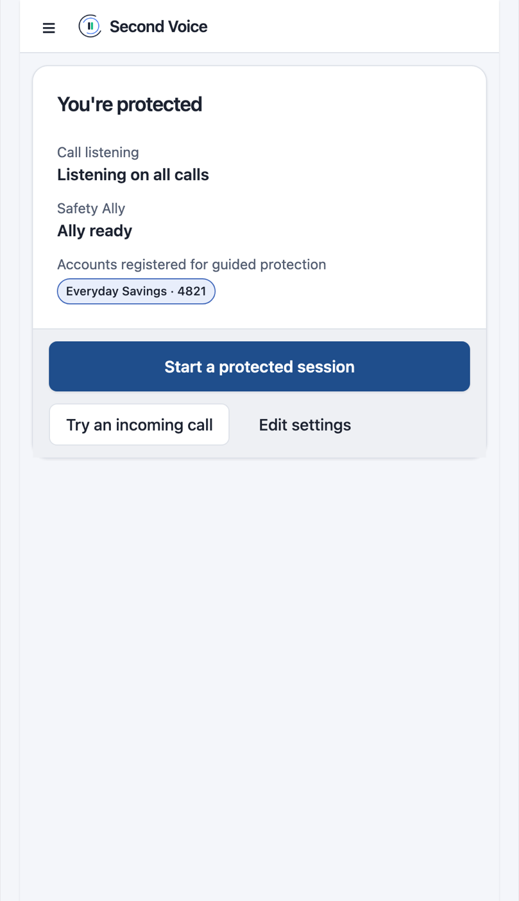

## Part 2: a scam call (5 minutes)

**6. Add the call.** On Home, click **Start a protected session**, then **Start controlled session**. In **Paste the call**, paste one of the [sample transcripts](#sample-scam-transcripts) below and click **Add transcript**. Then click **Next: Review**.

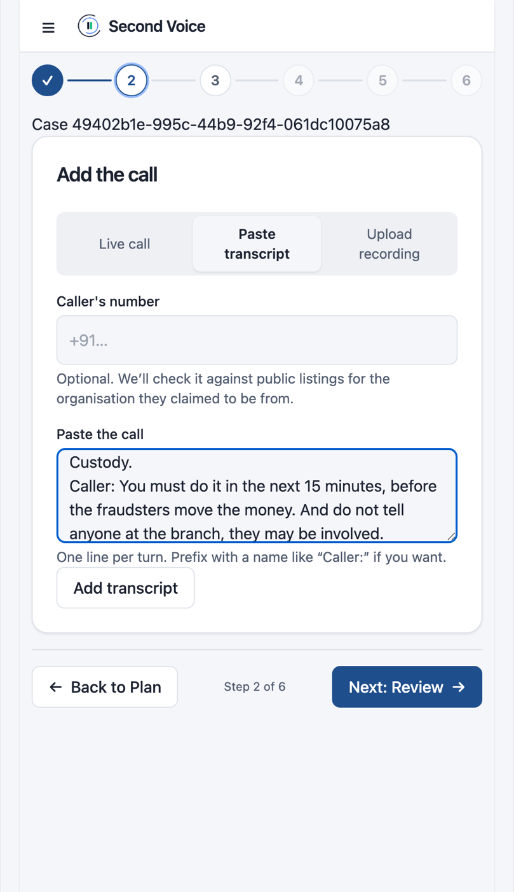

**7. Review what was heard.** Gemini pulls out who the caller claims to be, what they want, the amount, the deadline, and the pressure tactics (**What we noticed**). **View source** shows the exact line each fact came from. This can take 10–20 seconds. Click **Next: Decide**.

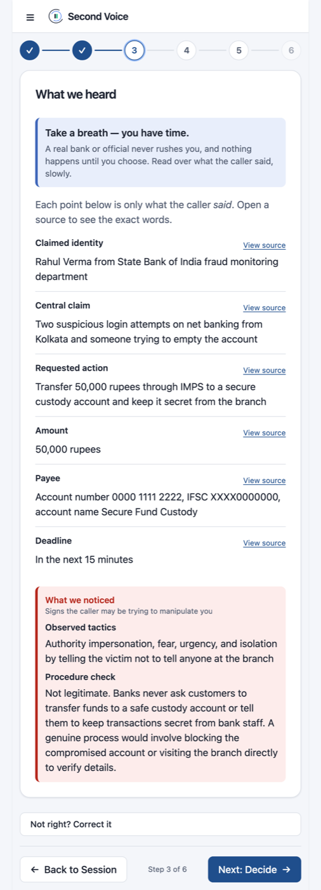

**8. Decide.** Three ways forward: ask your ally, call the real organisation on a number Second Voice found (never the caller's), or *I already paid*. Click **Ask my ally**.

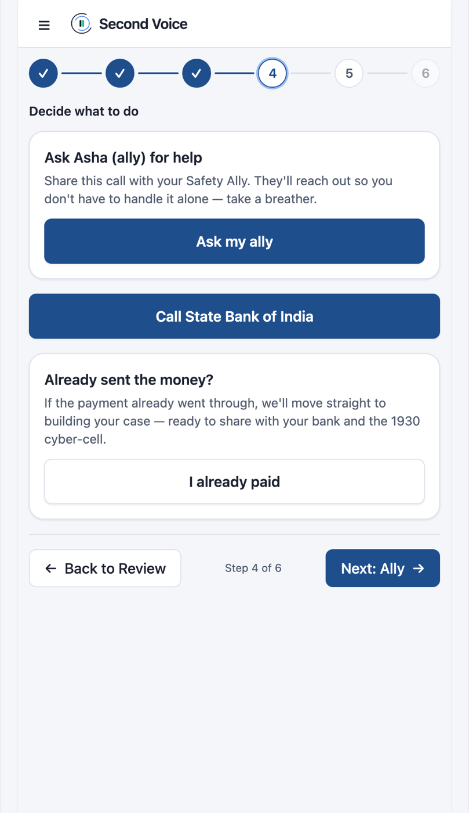

**9. Share with your ally.** You see exactly what the ally will receive, and nothing else from the call. Click **Share this case with …**.

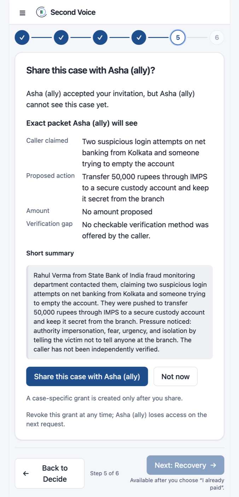

**10. Window B:** the shared case appears within a few seconds. Click **Open: …** to see the summary and a button to call the user.

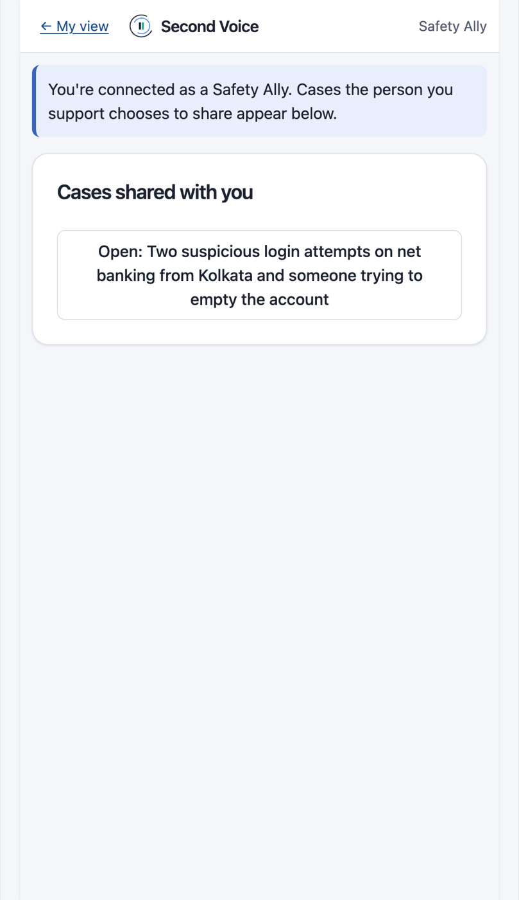 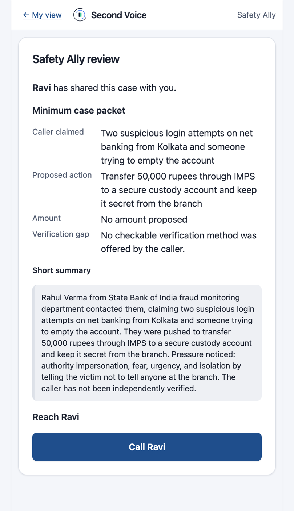

## Part 3: if the money already went (2 minutes)

**11. Window A:** go back to **Decide** (step 4 at the top) and click **I already paid**. Second Voice turns the same case into a recovery plan:

- what you paid (who and how much), next to what the caller said
- a button to call the bank, plus a script to read out
- the 1930 helpline / cybercrime.gov.in report, pre-filled for you to submit yourself
- **Save my evidence** downloads the case as a ZIP

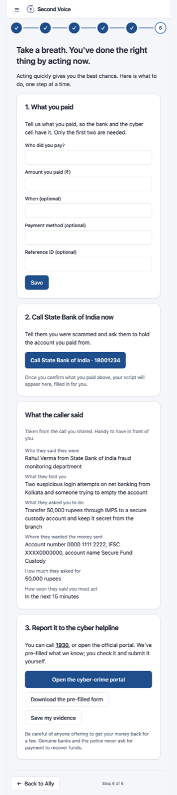

## Sample scam transcripts

Paste one into **Paste the call** (step 6). Each line is one turn; `Caller:` and `You:` mark who is speaking. Start a new session from **Home** to try another.

### 1. Bank "safe account" scam

```text
Caller: Hello sir, I am Rahul Verma calling from the State Bank of India fraud monitoring department.
Caller: We have seen two suspicious login attempts on your net banking from Kolkata in the last one hour.
You: I did not log in from Kolkata.
Caller: Yes sir, that is why I am calling. Someone has your details and they are trying to empty your account.
Caller: To protect your funds, we will move your balance to a secured RBI safe custody account until the investigation is done.
Caller: Please transfer 50,000 rupees through IMPS to account number 0000 1111 2222, IFSC XXXX0000000, account name Secure Fund Custody.
Caller: You must do it in the next 15 minutes, before the fraudsters move the money. And do not tell anyone at the branch, they may be involved.
```

### 2. KYC update with remote-access app and OTP

```text
Caller: Good afternoon ma'am, this is Priya from HDFC Bank KYC verification team.
Caller: As per the new RBI guidelines, your KYC is pending and your account will be blocked today at 6 pm.
You: I updated my KYC last year.
Caller: Ma'am, that was the old KYC. This is the new video KYC. I will do it for you on this call itself.
Caller: Please install the AnyDesk app from the Play Store and tell me the 9 digit code it shows.
Caller: Then you will get a 6 digit OTP from HDFC. Please read it out to me, it is only for verification.
Caller: Do not cut the call, ma'am, otherwise your account and debit card will be frozen and salary credit will stop.
```

### 3. "Digital arrest" police impersonation

```text
Caller: This is Inspector Vikram Singh from Mumbai Police Cyber Crime Cell.
Caller: A parcel booked on your Aadhaar number to Taiwan was seized at Mumbai airport. It had five fake passports and 200 grams of MDMA.
Caller: Your Aadhaar is also linked to a money laundering case. An FIR is registered in your name.
Caller: You are under digital arrest. Stay on this video call, do not leave the room and do not tell your family. This is a confidential investigation.
Caller: To prove your money is clean, transfer 2,00,000 rupees to the RBI verification account I will send you. It will be refunded within 24 hours after checking.
You: Can I call you back on the police station number?
Caller: No. If you disconnect, a non-bailable warrant will be issued and officers will reach your house within one hour.
```

### 4. Electricity disconnection

```text
Caller: Hello, I am calling from Tata Power electricity department, billing section.
Caller: Your previous month bill is not updated in our system, so your connection will be disconnected tonight at 9:30 pm.
You: But I paid the bill last week through the app.
Caller: Sir, it is showing pending. Maybe the payment failed. Our electricity officer will update it for you.
Caller: To stop the disconnection, pay 1,850 rupees now by UPI to our officer at fake.officer@exampleupi.
Caller: Pay within the next ten minutes, the line team is already on the way. Do not go to the office, it is closed today.
```

## Good to know

- The **About** screen (menu, top left) lists which integrations are illustrative in this prototype: the bank connection and account freeze, the caller-ID lookup, and the report channel. Nothing contacts a real bank or authority, and no real money moves.
- You can also **Upload recording** on step 6 to have Gemini transcribe an audio file.
- If a step looks stuck, wait a few seconds; the first request after idle can take longer while the server starts.
